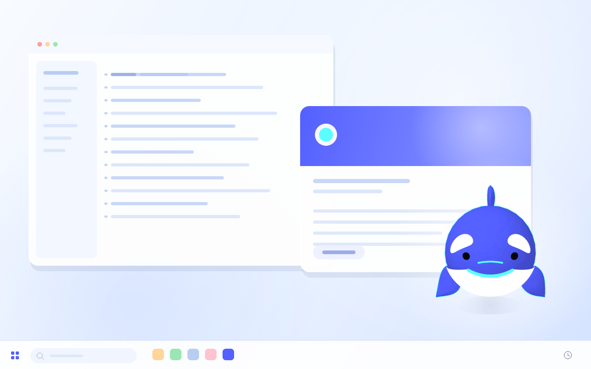
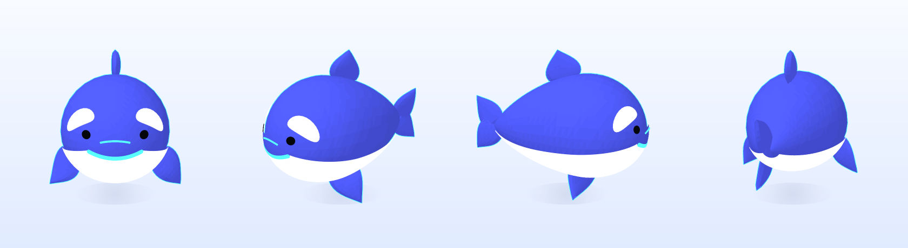
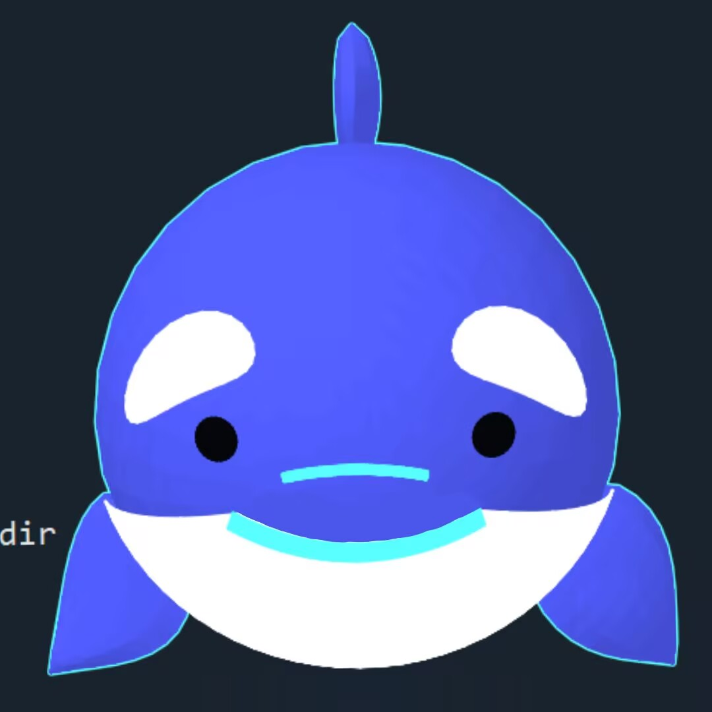
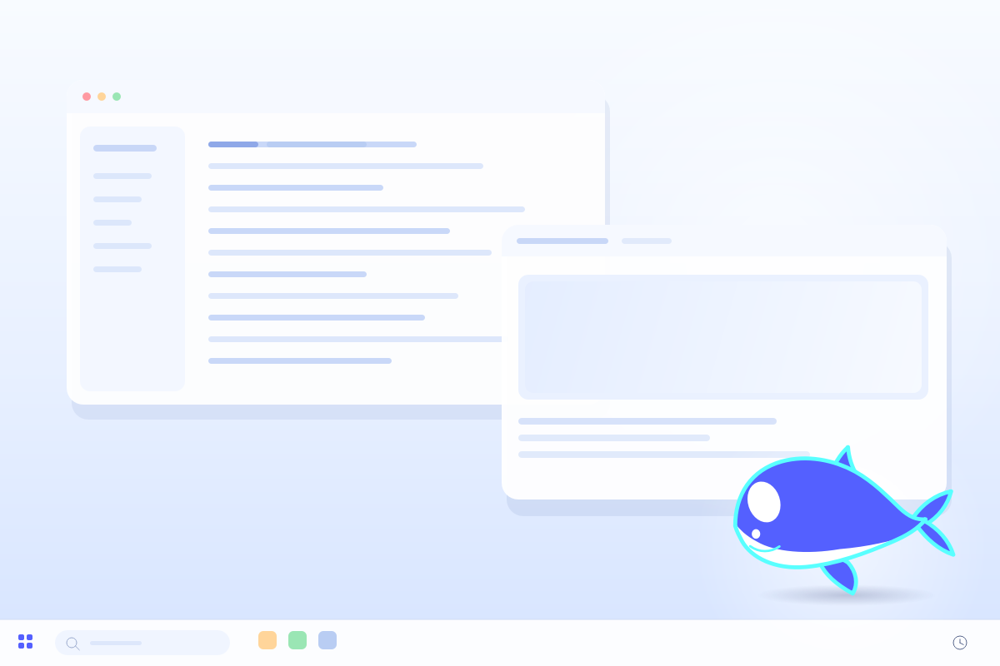

# 汐汐的小鲸鱼桌宠 · 3D 版

用 **Python + PyQt5** 写的一只小鲸鱼桌宠。它是真正的 **3D 网格**，不是平面贴图，也不是预渲染的序列帧：启动后可以用鼠标拖动，从正面、侧面、背面、上方观察它。

只依赖 PyQt5，**不需要 OpenGL、numpy、Blender 或任何模型文件**，在 VSCode 里直接运行即可。



> 小鲸鱼会出现在屏幕右下角，透明背景、始终置顶，不会占用任务栏。

## 可以旋转的 3D 小鲸鱼

从左到右：正面 / 3/4 侧面 / 侧面 / 背面。



这次没有做喂食、点击反应等互动，只专注把形象和“可旋转观察”做出来。造型参考的是 [汐汐的小鲸鱼设定图](reference.jpg)：水滴形身体、深蓝背、白色肚皮、八字眼斑、微笑、小三角背鳍、叶片胸鳍和剪刀尾。

### 第二版比例微调

- 头部明显放大，接近球形，成为全身视觉中心；
- 最宽点前移到鼻尖后约 1/3 处，从头部到背部再到尾柄平滑收窄，去掉第一版的鱼雷感；
- 含尾鳍的总身长约为头长的 1.8 倍，符合“头大身小”的呆萌比例；
- 眼斑随头部放大并前移，正面能同时看到一对完整的白色眼斑；
- 胸鳍、背鳍和尾鳍同步放大，避免被大头衬得过小。

### 最新一版：再缩短后半身

- **头部大小完全不变**，只缩短从头部后侧到尾柄的长度；
- 与上一版相比，后半身缩短约 10%，侧面轮廓更圆、更短；
- 眼斑、嘴巴和鳍的位置按“鼻尖后的固定物理距离”自动换算，不会因为缩短身体而挤向脸部；
- 尾鳍保留完整的大小，保证水滴形尾巴仍然清晰。

### 面部微调：左右眼斑对称

- 修复了左眼镜像时 `d_theta` 被翻转两次的问题：之前左眼其实是“上下翻转”的版本，所以和右眼形状不一致；
- 现在左右眼斑使用同一套右眼几何，再整体沿 X 轴镜像，形状严格左右对称；
- 默认视角从 3/4 侧面改为正对镜头（`INITIAL_YAW = 0.0`），启动时第一眼就能看到对称的正面；
- 旋转到侧面时仍保留自然透视，不影响 3D 观察。

### 嘴巴微调：一条平滑的微笑曲线

- 旧版嘴巴沿着鼻尖附近的 `(q, theta)` 参数绕圈，鼻尖处半径趋近 0，曲线在正中间容易折出一个尖点；
- 新版改为先在正面的 `x-z` 平面定义一条连续曲线：

```text
x = width * u
z = center_z + lift * u²
```

- 再用 `_front_surface_point()` 反求它在头部表面上的位置，贴到脸上；
- 于是嘴巴变成 **一条连续、左右对称、中间没有尖点** 的微笑线，嘴角自然上扬；
- `MOUTH_WIDTH`、`MOUTH_CENTER_Z`、`MOUTH_LIFT` 三个参数可以单独调整嘴巴的宽窄和微笑弧度。

### 背面隐藏吻部弧线

- 吻部弧线是凸出面部的小细管；之前为了从正面稳定绘制，给它加了较大的深度偏移，结果从背面也会盖到身体上；
- 现在保留正面的深度偏移，同时给这个网格加上 `front_only` 标记，根据旋转后的面部朝向判断是否绘制；
- 当面部转离镜头约 80° 以上时，整条吻部弧线会停止绘制，所以背面和侧后方不会再看到它；
- 正面和 3/4 视角下仍然正常显示。

### 面部细节：黑眼睛、吻部弧线和青色小点



- **去掉中央青色小点**：身体是参数曲面，鼻尖和尾尖原本收束成极点但没有封口，背后的青色描边会从鼻尖针孔透出来，看起来像一个小青点。现在给鼻尖和尾尖都补上了蓝色封盖；
- **黑色眼睛**：在左右白色眼斑下方各增加一个黑色圆形贴片。眼睛先在正面 `x-z` 平面生成圆形，再贴合到蓝色面部表面，并沿 X 轴镜像；
- **吻部小弧线**：在鼻梁中央增加一条短的青色弧线，中间略高、两端略低。它用细管网格生成而不是平面缎带，因此拱形最高点也不会退化成尖点；
- **吻部填蓝**：在吻部弧线和微笑线之间加一块贴合面部的蓝色贴片，把原本露出来的白色肚皮盖住。贴片下边缘沿着微笑线，嘴巴两端又加了圆角端帽，所以现在白色只从微笑线下方开始；
- 黑色眼睛、白色眼斑和吻部弧线的位置都由 `PUPIL_CENTER_X`、`PUPIL_CENTER_Z`、`SNOUT_WIDTH`、`SNOUT_CENTER_Z` 等参数控制；蓝色吻部贴片由 `MUZZLE_WIDTH`、`MUZZLE_TOP_Z` 控制。

## 直接运行（VSCode）

项目里已经准备好 `.venv`（Python 3.7 + PyQt5 5.15.4），按下面步骤即可：

1. 用 VSCode 打开 `whale_pet` 文件夹。
2. `Ctrl+Shift+P` → **Python: Select Interpreter** → 选择 `.venv\Scripts\python.exe`。
3. 按 `F5`，在启动配置里选择 **运行 3D 小鲸鱼（推荐）**。
4. 也可以直接在集成终端运行：

```powershell
.\.venv\Scripts\python.exe whale_pet_3d.py
```

如果 `.venv` 不存在，重新创建并安装依赖：

```powershell
python -m venv .venv
.\.venv\Scripts\python.exe -m pip install -r requirements.txt
.\.venv\Scripts\python.exe whale_pet_3d.py
```

> 推荐 Windows 10/11。macOS / Linux 也能运行 Qt 窗口，但透明背景和置顶效果在不同桌面环境下可能有差异。

## 操作

| 操作 | 效果 |
| --- | --- |
| **左键拖动** | 旋转小鲸鱼，水平 360°，上下可看到背部和肚皮 |
| **右键拖动** | 移动桌宠到屏幕任意位置 |
| **Shift + 左键拖动** | 也是移动桌宠（不想用右键时） |
| **滚轮** | 放大 / 缩小 |
| **左键双击** | 回到初始视角 |
| **右键单击** | 打开菜单：自动旋转展示 / 重置视角 / 回到右下角 / 退出 |

> 右键“拖动”和右键“单击”是区分开的：按住右键移动超过 3 像素就是移动桌宠，基本不动才会弹出菜单。
>
> 窗口没有任务栏图标，退出请在小鲸鱼上右键 →「退出小鲸鱼」。

## 颜色与造型

配色严格取自设定图，集中在 `whale3d.py` 顶部：

```python
BLUE = (0x54, 0x60, 0xFF)   # H236 S67 V100 填充蓝
WHITE = (0xFF, 0xFF, 0xFF)  # H0   S0  V100 纯白
CYAN = (0x59, 0xFF, 0xFF)   # H180 S65 V100 勾线蓝
```

3D 造型由这些部分组成：

- **身体**：头部接近球形并占身体大部分；前 1/3 鼓起，之后沿背部平滑收窄到尾柄，整体是水滴形而不是前后对称的鱼雷形；含尾鳍的总长约头长的 1.8 倍；
- **肚皮**：贴合身体下侧、稍微外扩的白色曲面，不是简单贴一张图；
- **眼斑 / 眼睛**：按设定图做成倾斜的白色“八”字眼斑，左右严格镜像对称；白色眼斑下方各有一颗黑色圆形眼睛；
- **吻部**：鼻梁中央有一条青色小弧线，中间高、两端低；两条青色弧线之间用一块贴合面部的蓝色贴片填满，白色肚皮只从微笑线下方开始；
- **微笑**：在正面 `x-z` 平面定义为一条平滑连续的微笑曲线，再贴合到面部曲率上，中间没有折点；
- **背鳍 / 胸鳍 / 尾鳍**：有厚度的叶片网格，胸鳍和尾鳍都是独立几何体；
- **描边**：每一帧投影后取外轮廓凸包，先铺一层青色，再画本体，得到干净的卡通描边。

## 实现原理（为什么不用 OpenGL 也能 3D）

1. `whale3d.py` 用参数方程生成身体和鳍的三角形网格，并计算每个顶点的法线；
2. 每帧根据鼠标角度做绕 Z 轴旋转、绕 X 轴俯仰；
3. 使用固定相机做透视投影，先剔除背面，再按深度从远到近绘制三角形；
4. 每个三角形根据法线和方向光做 Toon 明暗，并缓存颜色，减少重复计算；
5. 用 `QPainter` 在透明 `QImage` 上完成抗锯齿绘制。

因为完全是 CPU 软件渲染，所以 **不需要显卡加速或 OpenGL 上下文**，兼容性更好；代价是旋转时的帧率大约在 20–25 FPS（400px 窗口）。程序在拖动时会自动用稍低一点的分辨率渲染，松手后恢复全分辨率；待机时只重绘缓存图，几乎不占 CPU。

## 可调参数

`whale_pet_3d.py` 顶部：

```python
PET_SIZE = 400          # 窗口边长
SCREEN_MARGIN = 24      # 离屏幕右下角的距离
INITIAL_YAW = 0.0       # 初始水平角度：0 = 正面视角
INITIAL_PITCH = 1.5     # 初始俯仰角度
INITIAL_ZOOM = 1.04     # 初始缩放
IDLE_BOB = True         # 待机时轻微上下浮动
SHOW_HINT = True        # 启动时显示 5 秒操作提示
DRAG_RENDER_SCALE = 0.84  # 拖动时的临时渲染比例
```

如果电脑比较旧、旋转不够流畅，可以把 `PET_SIZE` 改成 `340`，或者把 `DRAG_RENDER_SCALE` 调低到 `0.72`。

如果还想继续调整胖瘦和长短，打开 `whale3d.py` 顶部：

- `TAIL_Y` 控制身体总长；缩短时要同时把 `HEAD_Q` 设为 `0.736 / (TAIL_Y - HEAD_Y)`，这样头部物理尺寸保持不变；
- `BODY_WIDTH`、`BODY_TOP`、`BODY_BOTTOM` 控制头部宽度和上下高度；
- `MOUTH_WIDTH`、`MOUTH_CENTER_Z`、`MOUTH_LIFT` 控制嘴巴宽度、位置和嘴角上扬幅度；
- `PUPIL_CENTER_X`、`PUPIL_CENTER_Z`、`PUPIL_RADIUS` 控制黑色眼睛的位置和大小；
- `SNOUT_WIDTH`、`SNOUT_CENTER_Z`、`SNOUT_DROP` 控制吻部弧线的宽度、高度和弯曲程度；
- `MUZZLE_WIDTH`、`MUZZLE_TOP_Z` 控制蓝色吻部贴片的宽度和上边缘高度；
- 眼斑、眼睛、嘴巴、背鳍和胸鳍的位置已经改成按“鼻尖后的固定距离/正面坐标”换算，缩短身体时不会挤到脸上。

## 文件结构

```text
whale_pet/
├─ whale_pet_3d.py          # 3D 桌宠主程序（推荐运行）
├─ whale3d.py               # 3D 小鲸鱼模型 + 软件渲染器
├─ render_preview_3d.py     # 生成桌面图 / 多角度图（开发用）
├─ preview_3d.png           # 桌面效果预览
├─ whale_3d_views.png       # 正面、3/4、侧面、背面
├─ whale_3d_transparent.png # 透明背景大图
├─ reference.jpg            # 原始设定图
├─ reference_face.jpg       # 面部细节参考图
├─ requirements.txt         # PyQt5
├─ .vscode/
│  ├─ launch.json           # 3D / 2D / tkinter 三个启动配置
│  └─ settings.json
├─ whale_pet.py             # 附带的 2D PyQt5 版
├─ whale_pet_tk.py          # 附带的 2D tkinter 版
├─ preview.png              # 2D PyQt5 版预览
└─ preview_tk.png           # 2D tkinter 版预览
```

## 附带的 2D 备选版

如果只想看平面版，仓库里保留了原来的两个版本，功能和操作与之前一致：

```powershell
# 2D PyQt5 版
.\.venv\Scripts\python.exe whale_pet.py

# 2D tkinter 版（零第三方依赖）
.\.venv\Scripts\python.exe whale_pet_tk.py
```



## 常见问题

**提示 `No module named 'PyQt5'`**

说明当前解释器不是项目里的 `.venv`，或者依赖没装：

```powershell
.\.venv\Scripts\python.exe -m pip install -r requirements.txt
```

**运行后看不到小鲸鱼**

先看屏幕右下角；它默认在右下角、窗口约 400×400。它没有任务栏图标，可能被其他置顶窗口挡住。重新运行后立刻在右下角找一下；如果被拖出屏幕，重开程序会回到右下角。

**右键拖动后没有弹出菜单**

这是正常的：右键按住移动会移动桌宠，只有右键基本不动（移动小于 3 像素）才会弹出菜单。

**旋转时帧率一般**

软件 3D 渲染的预期表现。可以降低 `PET_SIZE` 或 `DRAG_RENDER_SCALE`；待机展示是缓存的，不受影响。

**想换成自己的比例 / 风格**

`whale3d.py` 里的 `_build_body`、`_build_belly`、`_build_eye_patch`、`_build_pectoral` 都是独立的参数化函数，可以单独改身体轮廓、眼斑大小、鳍的长度和角度。

## 测试环境

- Windows 10/11
- Python 3.7.3
- PyQt5 5.15.4
- 2560×1600 屏幕实测：透明背景、右下角启动、置顶、右键菜单正常

后续如果要加点击反应、喂食、拖拽惯性或语音气泡，可以在这个 3D 形象层上继续扩展。
