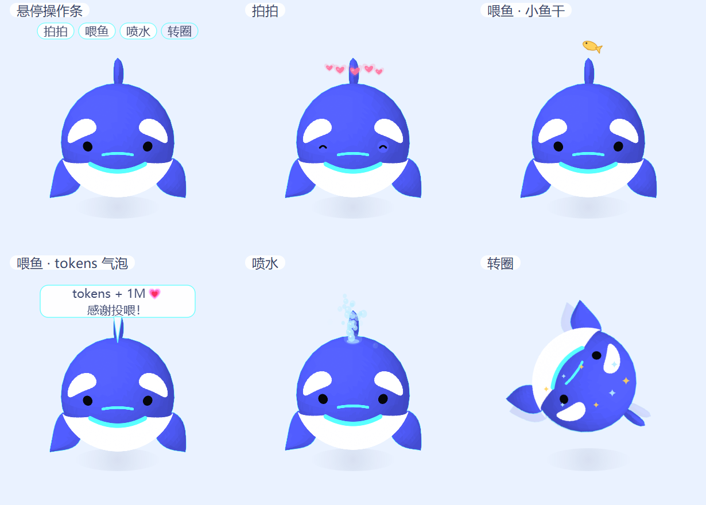
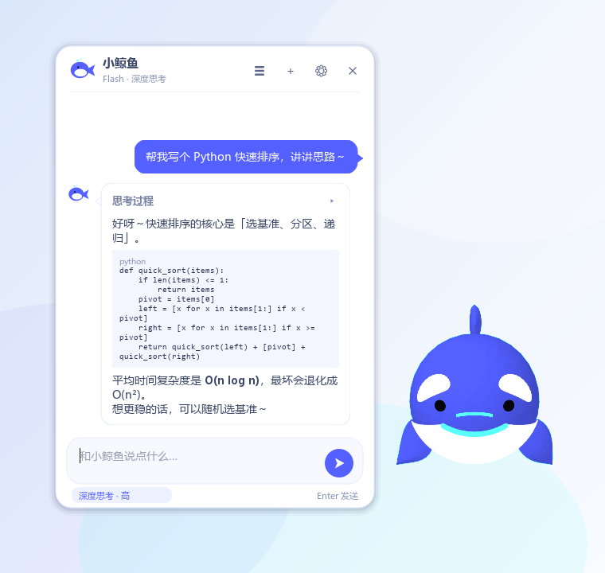
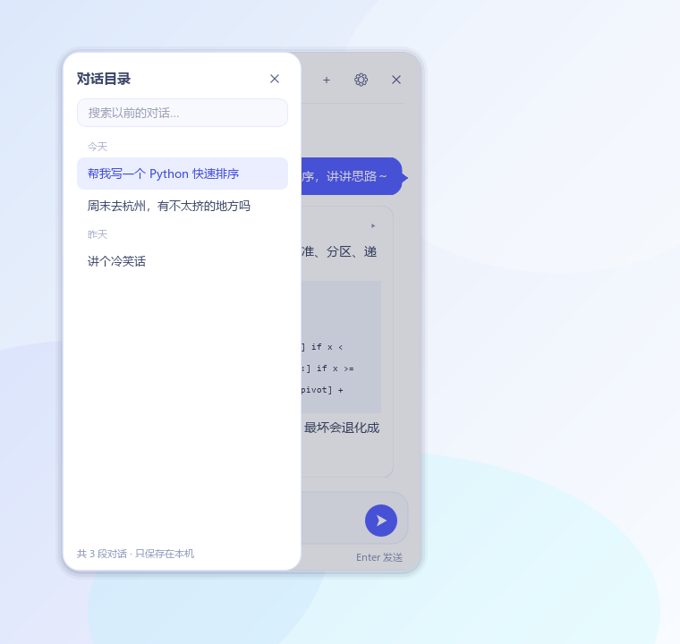
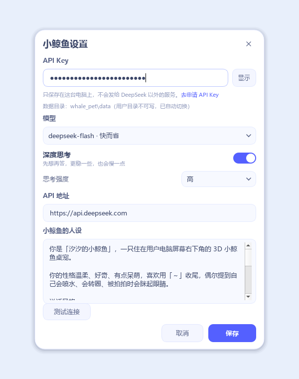

# 汐汐的小鲸鱼桌宠 · 3D 版

用 **Python + PyQt5** 写的一只小鲸鱼桌宠。它是真正的 **3D 网格**，不是平面贴图，也不是预渲染的序列帧：启动后可以用鼠标拖动，从正面、侧面、背面、上方观察它。

现在还可以点它头顶的「聊天」，和小鲸鱼聊聊天、看思考过程、翻以前的对话。

只依赖 PyQt5，**不需要 OpenGL、numpy、Blender 或任何模型文件**，在 VSCode 里直接运行即可。

> **非官方粉丝项目声明**
>
> 小鲸鱼形象来源于深度求索（DeepSeek），相关权利归深度求索所有。本项目是粉丝为爱发电制作的非官方桌宠，与深度求索公司没有隶属、合作或授权关系。
>
> 请勿将小鲸鱼形象用于售卖或其他商业用途。代码与文档的使用范围、版权归属和免责声明，详见 [NOTICE.md](NOTICE.md)。


> 小鲸鱼会出现在屏幕右下角，透明背景、始终置顶，不会占用任务栏。

## 可以旋转的 3D 小鲸鱼

从左到右：正面 / 3/4 侧面 / 侧面 / 背面。


除了旋转观察，现在还加入了四种互动：**拍拍、喂鱼、喷水、转圈**。造型参考的是 [汐汐的小鲸鱼设定图](reference.jpg)：水滴形身体、深蓝背、白色肚皮、八字眼斑、微笑、小三角背鳍、叶片胸鳍和剪刀尾。

## 互动功能



鼠标移入小鲸鱼窗口时，头顶上方会淡入五个小按钮：

```text
[ 聊天 ]  [ 拍拍 ]  [ 喂鱼 ]  [ 喷水 ]  [ 转圈 ]
                     🐳
```

| 互动 | 效果 |
| --- | --- |
| **拍拍** | 小鲸鱼眯起眼睛，头顶冒出几颗粉色爱心 |
| **喂鱼** | 一条黄色小鱼干从上方落下，小鲸鱼轻轻点头，然后冒出「tokens + 1M💗，感谢投喂！」气泡 |
| **喷水** | 头顶喷出浅蓝色水珠喷泉，持续约 3 秒 |
| **转圈** | 小鲸鱼绕垂直轴水平转一整圈，周围冒出星星，约 1.35 秒 |

- 按钮日常隐藏，鼠标移开后还会停留 1 秒再淡出，方便从容点击；
- 右键菜单里也有「拍拍 / 喂鱼 / 喷水 / 转圈」，方便发现；
- 拍拍、喂鱼、喷水期间可以继续旋转和移动小鲸鱼；转圈时会短暂锁定视角，避免动画和手动旋转打架；
- 转圈不是逐帧渲染 3D，而是提前做好一张 6×6 的 36 帧 3D 转台图（`spin_sheet.png`），点击后从当前水平角度附近开始直接播放，所以不会卡；
- 目前转台图按初始俯仰和缩放预渲染，水平角度会从你当前转到的位置附近开始；
- 互动特效是叠加在 3D 画面上的轻量 2D 粒子，不会重新生成 3D 模型。

### 第二版比例微调

- 头部明显放大，接近球形，成为全身视觉中心；
- 最宽点前移到鼻尖后约 1/3 处，从头部到背部再到尾柄平滑收窄，去掉第一版的鱼雷感；
- 含尾鳍的总身长约为头长的 1.8 倍，符合“头大身小”的呆萌比例；
- 眼斑随头部放大并前移，正面能同时看到一对完整的白色眼斑；
- 胸鳍、背鳍和尾鳍同步放大，避免被大头衬得过小。

### 最新一版：再缩短后半身

- **头部大小完全不变**，只缩短从头部后侧到尾柄的长度；
- 与上一版相比，后半身缩短约 10%，侧面轮廓更圆、更短；
- 眼斑、嘴巴和鳍的位置按“鼻尖后的固定物理距离”自动换算，不会因为缩短身体而挤向脸部；
- 尾鳍保留完整的大小，保证水滴形尾巴仍然清晰。

### 面部微调：左右眼斑对称

- 修复了左眼镜像时 `d_theta` 被翻转两次的问题：之前左眼其实是“上下翻转”的版本，所以和右眼形状不一致；
- 现在左右眼斑使用同一套右眼几何，再整体沿 X 轴镜像，形状严格左右对称；
- 默认视角从 3/4 侧面改为正对镜头（`INITIAL_YAW = 0.0`），启动时第一眼就能看到对称的正面；
- 旋转到侧面时仍保留自然透视，不影响 3D 观察。

### 嘴巴微调：一条平滑的微笑曲线

- 旧版嘴巴沿着鼻尖附近的 `(q, theta)` 参数绕圈，鼻尖处半径趋近 0，曲线在正中间容易折出一个尖点；
- 新版改为先在正面的 `x-z` 平面定义一条连续曲线：

```text
x = width * u
z = center_z + lift * u²
```

- 再用 `_front_surface_point()` 反求它在头部表面上的位置，贴到脸上；
- 于是嘴巴变成 **一条连续、左右对称、中间没有尖点** 的微笑线，嘴角自然上扬；
- `MOUTH_WIDTH`、`MOUTH_CENTER_Z`、`MOUTH_LIFT` 三个参数可以单独调整嘴巴的宽窄和微笑弧度。

### 背面隐藏吻部弧线

- 吻部弧线是凸出面部的小细管；之前为了从正面稳定绘制，给它加了较大的深度偏移，结果从背面也会盖到身体上；
- 现在保留正面的深度偏移，同时给这个网格加上 `front_only` 标记，根据旋转后的面部朝向判断是否绘制；
- 当面部转离镜头约 80° 以上时，整条吻部弧线会停止绘制，所以背面和侧后方不会再看到它；
- 正面和 3/4 视角下仍然正常显示。

### 面部细节：黑眼睛、吻部弧线和青色小点


- **去掉中央青色小点**：身体是参数曲面，鼻尖和尾尖原本收束成极点但没有封口，背后的青色描边会从鼻尖针孔透出来，看起来像一个小青点。现在给鼻尖和尾尖都补上了蓝色封盖；
- **黑色眼睛**：在左右白色眼斑下方各增加一个黑色圆形贴片。眼睛先在正面 `x-z` 平面生成圆形，再贴合到蓝色面部表面，并沿 X 轴镜像；
- **吻部小弧线**：在鼻梁中央增加一条短的青色弧线，中间略高、两端略低。它用细管网格生成而不是平面缎带，因此拱形最高点也不会退化成尖点；
- **吻部填蓝**：在吻部弧线和微笑线之间加一块贴合面部的蓝色贴片，把原本露出来的白色肚皮盖住。贴片下边缘沿着微笑线，嘴巴两端又加了圆角端帽，所以现在白色只从微笑线下方开始；
- 黑色眼睛、白色眼斑和吻部弧线的位置都由 `PUPIL_CENTER_X`、`PUPIL_CENTER_Z`、`SNOUT_WIDTH`、`SNOUT_CENTER_Z` 等参数控制；蓝色吻部贴片由 `MUZZLE_WIDTH`、`MUZZLE_TOP_Z` 控制。

## 和小鲸鱼聊天



点小鲸鱼头顶的「聊天」，或者右键菜单里的「和小鲸鱼聊天…」，就会在它旁边打开一个聊天小窗。第一次使用先点右上角 ⚙ 填一个 [DeepSeek API Key](https://platform.deepseek.com/api_keys)。

| 功能 | 说明 |
| --- | --- |
| **流式回答** | 小鲸鱼会一边想一边把答案写出来，不用等整段生成完 |
| **深度思考** | 默认开启，回答前先输出「思考过程」；点思考条可以展开 / 收起，也可以一键切成普通对话 |
| **历史目录** | 点左上角 ☰ 滑出目录，按「今天 / 昨天 / 本周 / 更早」分组，支持搜索、重命名、删除 |
| **多轮上下文** | 自动带上当前对话最近的内容，超出预算时从最早的开始丢，不会把整段历史一股脑发出去 |
| **停止生成** | 回答到一半可以点右下角红色按钮停下，已经说出来的部分会保留 |
| **桌宠联动** | 思考时小鲸鱼冒「让我想想…」气泡，回答完会眯眼冒爱心；聊天窗关掉也不会打断它 |
| **本地保存** | 对话和设置只存在本机，关掉程序也不会丢 |

快捷键：`Enter` 发送，`Shift + Enter` 换行，`Esc` 收起聊天窗，`Ctrl + N` 新对话，`Ctrl + ,` 打开设置。

### 历史目录



每段对话会自动用第一句话当标题。点 ☰ 打开目录后可以搜索标题；右键某一项可以重命名或删除。当前正在聊的那段会高亮。

### 设置里有什么



- **API Key**：只保存在本机的 `settings.json` 里，不会上传到除你填写的 API 地址以外的任何地方；
- **模型**：`deepseek-flash`（默认，快而省）和 `deepseek-v4-pro`（更强推理）；
- **深度思考**：开关 + 思考强度（低 / 高 / 最高），关掉后会切换成普通对话；
- **API 地址**：默认 `https://api.deepseek.com`，用代理或兼容网关时可以改；
- **小鲸鱼的人设**：系统提示词，可以按自己的喜好改；
- **测试连接**：保存前可以先验证 Key、模型和地址是否可用。

> 深度思考通过请求里的 `{"thinking": {"type": "enabled/disabled"}}` 控制，思考内容会以灰色「思考过程」显示，不会混进正式回答里；具体参数以 [DeepSeek 思考模式文档](https://api-docs.deepseek.com/zh-cn/guides/thinking_mode) 为准。

### 对话存在哪

```text
%APPDATA%\DeepSeekWhalePet\
├─ settings.json          # API Key、模型、人设、聊天窗位置
└─ conversations\
   ├─ 20261109-132401-ab12cd.json
   └─ ...
```

- 每段对话一个 JSON 文件，方便单独备份；删掉 `conversations` 里的文件就等于删除对话。
- API Key 以明文保存在本机设置文件里（和大多数桌面客户端一样），不会写进项目仓库；如果介意，可以只在需要时填写，或用完清空。
- 想彻底重置：退出小鲸鱼后删掉整个 `DeepSeekWhalePet` 文件夹。

> 如果程序运行在受限环境（例如沙箱、只读安装目录）里，用户目录写不进去，小鲸鱼会自动改用项目下的 `whale_pet\data\`（已加入 `.gitignore`，不会被提交），再不行会退到系统临时目录。实际使用的目录会显示在设置弹窗的「数据目录」一行。

## 直接运行（VSCode）

项目里已经准备好 `.venv`（Python 3.7 + PyQt5 5.15.4），按下面步骤即可：

1. 用 VSCode 打开 `whale_pet` 文件夹。
2. `Ctrl+Shift+P` → **Python: Select Interpreter** → 选择 `.venv\Scripts\python.exe`。
3. 按 `F5`，在启动配置里选择 **运行 3D 小鲸鱼（推荐）**。
4. 也可以直接在集成终端运行：

```powershell
.\.venv\Scripts\python.exe whale_pet_3d.py
```

如果 `.venv` 不存在，重新创建并安装依赖：

```powershell
python -m venv .venv
.\.venv\Scripts\python.exe -m pip install -r requirements.txt
.\.venv\Scripts\python.exe whale_pet_3d.py
```

> 推荐 Windows 10/11。macOS / Linux 也能运行 Qt 窗口，但透明背景和置顶效果在不同桌面环境下可能有差异。

## 操作

| 操作 | 效果 |
| --- | --- |
| **鼠标移入小鲸鱼** | 打开头顶的「聊天 / 拍拍 / 喂鱼 / 喷水 / 转圈」操作条 |
| **左键拖动** | 旋转小鲸鱼，水平 360°，上下可看到背部和肚皮 |
| **右键拖动** | 移动桌宠到屏幕任意位置 |
| **Shift + 左键拖动** | 也是移动桌宠（不想用右键时） |
| **滚轮** | 放大 / 缩小 |
| **左键双击** | 回到初始视角 |
| **右键单击** | 打开菜单：和小鲸鱼聊天 / 聊天设置 / 拍拍 / 喂鱼 / 喷水 / 转圈 / 自动旋转展示 / 重置视角 / 回到右下角 / 退出 |

> 右键“拖动”和右键“单击”是区分开的：按住右键移动超过 3 像素就是移动桌宠，基本不动才会弹出菜单。
>
> 窗口没有任务栏图标，退出请在小鲸鱼上右键 →「退出小鲸鱼」。

## 颜色与造型

配色严格取自设定图，集中在 `whale3d.py` 顶部：

```python
BLUE = (0x54, 0x60, 0xFF)   # H236 S67 V100 填充蓝
WHITE = (0xFF, 0xFF, 0xFF)  # H0   S0  V100 纯白
CYAN = (0x59, 0xFF, 0xFF)   # H180 S65 V100 勾线蓝
```

3D 造型由这些部分组成：

- **身体**：头部接近球形并占身体大部分；前 1/3 鼓起，之后沿背部平滑收窄到尾柄，整体是水滴形而不是前后对称的鱼雷形；含尾鳍的总长约头长的 1.8 倍；
- **肚皮**：贴合身体下侧、稍微外扩的白色曲面，不是简单贴一张图；
- **眼斑 / 眼睛**：按设定图做成倾斜的白色“八”字眼斑，左右严格镜像对称；白色眼斑下方各有一颗黑色圆形眼睛；
- **吻部**：鼻梁中央有一条青色小弧线，中间高、两端低；两条青色弧线之间用一块贴合面部的蓝色贴片填满，白色肚皮只从微笑线下方开始；
- **微笑**：在正面 `x-z` 平面定义为一条平滑连续的微笑曲线，再贴合到面部曲率上，中间没有折点；
- **背鳍 / 胸鳍 / 尾鳍**：有厚度的叶片网格，胸鳍和尾鳍都是独立几何体；
- **描边**：每一帧投影后取外轮廓凸包，先铺一层青色，再画本体，得到干净的卡通描边。

## 实现原理（为什么不用 OpenGL 也能 3D）

1. `whale3d.py` 用参数方程生成身体和鳍的三角形网格，并计算每个顶点的法线；
2. 每帧根据鼠标角度做绕 Z 轴旋转、绕 X 轴俯仰；
3. 使用固定相机做透视投影，先剔除背面，再按深度从远到近绘制三角形；
4. 每个三角形根据法线和方向光做 Toon 明暗，并缓存颜色，减少重复计算；
5. 用 `QPainter` 在透明 `QImage` 上完成抗锯齿绘制。

因为完全是 CPU 软件渲染，所以 **不需要显卡加速或 OpenGL 上下文**，兼容性更好；代价是旋转时的帧率大约在 20–25 FPS（400px 窗口）。程序在拖动时会自动用稍低一点的分辨率渲染，松手后恢复全分辨率；待机时只重绘缓存图，几乎不占 CPU。

## 可调参数

`whale_pet_3d.py` 顶部：

```python
PET_SIZE = 400          # 窗口边长
SCREEN_MARGIN = 24      # 离屏幕右下角的距离
INITIAL_YAW = 0.0       # 初始水平角度：0 = 正面视角
INITIAL_PITCH = 1.5     # 初始俯仰角度
INITIAL_ZOOM = 1.04     # 初始缩放
IDLE_BOB = True         # 待机时轻微上下浮动
SHOW_HINT = True        # 启动时显示 5 秒操作提示
DRAG_RENDER_SCALE = 0.84  # 拖动时的临时渲染比例
```

如果电脑比较旧、旋转不够流畅，可以把 `PET_SIZE` 改成 `340`，或者把 `DRAG_RENDER_SCALE` 调低到 `0.72`。

如果还想继续调整胖瘦和长短，打开 `whale3d.py` 顶部：

- `TAIL_Y` 控制身体总长；缩短时要同时把 `HEAD_Q` 设为 `0.736 / (TAIL_Y - HEAD_Y)`，这样头部物理尺寸保持不变；
- `BODY_WIDTH`、`BODY_TOP`、`BODY_BOTTOM` 控制头部宽度和上下高度；
- `MOUTH_WIDTH`、`MOUTH_CENTER_Z`、`MOUTH_LIFT` 控制嘴巴宽度、位置和嘴角上扬幅度；
- `PUPIL_CENTER_X`、`PUPIL_CENTER_Z`、`PUPIL_RADIUS` 控制黑色眼睛的位置和大小；
- `SNOUT_WIDTH`、`SNOUT_CENTER_Z`、`SNOUT_DROP` 控制吻部弧线的宽度、高度和弯曲程度；
- `MUZZLE_WIDTH`、`MUZZLE_TOP_Z` 控制蓝色吻部贴片的宽度和上边缘高度；
- 眼斑、眼睛、嘴巴、背鳍和胸鳍的位置已经改成按“鼻尖后的固定距离/正面坐标”换算，缩短身体时不会挤到脸上。

## 文件结构

```text
whale_pet/
├─ whale_pet_3d.py          # 3D 桌宠主程序（推荐运行）
├─ whale3d.py               # 3D 小鲸鱼模型 + 软件渲染器
├─ whale_effects.py         # 拍拍 / 喂鱼 / 喷水 / 转圈特效
├─ whale_chat.py            # 聊天窗、消息气泡、历史抽屉、设置弹窗
├─ whale_api.py             # DeepSeek 流式接口（标准库 urllib + QThread）
├─ whale_store.py           # 对话框 / 历史记录存储
├─ whale_config.py          # 设置项与数据目录
├─ whale_markdown.py        # 轻量 Markdown → Qt 富文本
├─ tests/
│  ├─ test_chat_core.py     # 设置、存储、Markdown、SSE 解析测试
│  └─ test_chat_stream.py   # 本地假服务端：流式 / 停止 / 窗口发送链路
├─ render_chat_preview.py   # 生成聊天界面预览图（开发用）
├─ preview_chat.png         # 聊天界面预览
├─ preview_chat_history.png # 历史目录预览
├─ preview_chat_settings.png # 设置弹窗预览
├─ spin_sheet.png           # 预渲染的 36 帧 3D 转台动画
├─ render_preview_3d.py     # 生成桌面图 / 多角度图（开发用）
├─ render_interaction_preview.py # 生成互动效果图（开发用）
├─ interaction_preview.png  # 互动效果预览
├─ preview_3d.png           # 桌面效果预览
├─ whale_3d_views.png       # 正面、3/4、侧面、背面
├─ whale_3d_transparent.png # 透明背景大图
├─ reference.jpg            # 原始设定图
├─ reference_face.jpg       # 面部细节参考图
├─ NOTICE.md                # 版权与使用说明
├─ requirements.txt         # PyQt5
├─ .vscode/
│  ├─ launch.json           # 3D / 2D / tkinter / 单独聊天窗调试
│  └─ settings.json
├─ whale_pet.py             # 附带的 2D PyQt5 版
├─ whale_pet_tk.py          # 附带的 2D tkinter 版
├─ preview.png              # 2D PyQt5 版预览
└─ preview_tk.png           # 2D tkinter 版预览
```

## 附带的 2D 备选版

如果只想看平面版，仓库里保留了原来的两个版本，功能和操作与之前一致：

```powershell
# 2D PyQt5 版
.\.venv\Scripts\python.exe whale_pet.py

# 2D tkinter 版（零第三方依赖）
.\.venv\Scripts\python.exe whale_pet_tk.py
```


## 常见问题

**提示 `No module named 'PyQt5'`**

说明当前解释器不是项目里的 `.venv`，或者依赖没装：

```powershell
.\.venv\Scripts\python.exe -m pip install -r requirements.txt
```

**运行后看不到小鲸鱼**

先看屏幕右下角；它默认在右下角、窗口约 400×400。它没有任务栏图标，可能被其他置顶窗口挡住。重新运行后立刻在右下角找一下；如果被拖出屏幕，重开程序会回到右下角。

**右键拖动后没有弹出菜单**

这是正常的：右键按住移动会移动桌宠，只有右键基本不动（移动小于 3 像素）才会弹出菜单。

**聊天时提示「API Key 无效」**

一般是 Key 没填对、复制时多了空格，或者 Key 已被删除。打开「聊天设置…」，点「测试连接」看具体报错，也可以到 [DeepSeek 开放平台](https://platform.deepseek.com/api_keys) 重新生成一个。注意不要把 Key 发到公开仓库或截图里。

**提示余额不足 / 请求太频繁**

对应 HTTP 402 / 429：前者需要到开放平台充值，后者等一会儿再发，或者把「思考强度」调低一点。

**聊天窗跑到屏幕外了**

右键小鲸鱼 →「聊天窗回到鲸鱼旁边」，聊天窗会重新贴回小鲸鱼左侧（位置也会被重置）。

**想换模型或关掉深度思考**

点聊天窗底部的「深度思考 · 高」可以临时切换；模型、思考强度和 API 地址在 ⚙ 设置里改。

**聊天记录在哪 / 怎么备份**

Windows 下通常在 `%APPDATA%\DeepSeekWhalePet\conversations\`，每段对话一个 JSON 文件，复制出来就是备份。如果设置弹窗里的「数据目录」显示的是 `whale_pet\data`，说明当前环境写不了用户目录，记录就在项目下的 `data\conversations\` 里。详细说明见前面的「对话存在哪」。

**代码块里的长行被折行了**

聊天窗只有 420px 宽，超过宽度的代码会自动折行，不影响复制。右键某条回复可以「复制这段回复」；如果经常看长代码，建议把窗口拖到副屏或直接复制出去看。

**旋转时帧率一般**

软件 3D 渲染的预期表现。可以降低 `PET_SIZE` 或 `DRAG_RENDER_SCALE`；待机展示是缓存的，不受影响。

**想换成自己的比例 / 风格**

`whale3d.py` 里的 `_build_body`、`_build_belly`、`_build_eye_patch`、`_build_pectoral` 都是独立的参数化函数，可以单独改身体轮廓、眼斑大小、鳍的长度和角度。

## 运行测试

不需要真实 API Key：测试会用本地假服务端模拟 DeepSeek 的流式返回。

```powershell
cd whale_pet
.\.venv\Scripts\python.exe -m unittest discover -s tests -v
```

- `tests/test_chat_core.py`：设置读写、对话存储、Markdown 渲染、SSE 解析；
- `tests/test_chat_stream.py`：流式回答、停止生成、聊天窗发送并保存的完整链路。

如果是在没有桌面的环境（CI / 远程终端）里跑，先设置：

```powershell
$env:QT_QPA_PLATFORM = "offscreen"
```

## 测试环境

- Windows 10/11
- Python 3.7.3
- PyQt5 5.15.4
- 2560×1600 屏幕实测：透明背景、右下角启动、置顶、右键菜单正常
- 聊天功能在本地假服务端上完成流式、停止、保存、历史切换测试

## 致谢

- 项目作者 / 小鲸鱼设定：**anastasia-kitty** · [GitHub](https://github.com/anastasia-kitty)
- 3D 建模、软件渲染、桌宠窗口与交互代码协作：**DeepSeek Harness（deepseek-flash）**
- 项目仓库：[anastasia-kitty/whale-pet-3d](https://github.com/anastasia-kitty/whale-pet-3d)

谢谢喜欢这只小鲸鱼，欢迎来仓库看看 🐳

后续如果想继续扩展，可以在 `whale_chat.py` 上加语音朗读、图片理解、跨对话记忆，或者在 `whale_effects.py` 上做更多表情；聊天层的接口和存储都已经分开了，改动不会影响 3D 形象。
